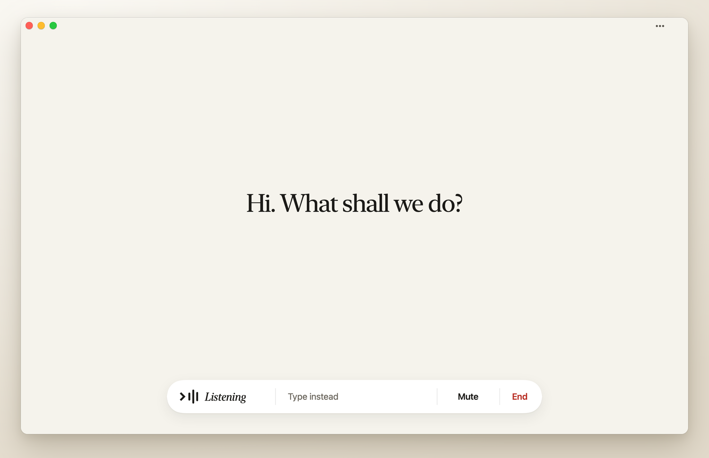

<picture><source media="(prefers-color-scheme: dark)" srcset="media/lockup-dark.png"></picture>

# Have a real conversation with Claude Code.

Think out loud. It answers out loud. Then it gets on with the work, and calls you back only when it matters.

  

 

<picture><source media="(prefers-color-scheme: dark)" srcset="media/oh-kevin-loop-dark.webp"></picture>

 

## Talk it through. Hand it off. Say yes.

<table>
<tr>
<td width="33%" valign="top"><h3>Talk it through</h3>Start a call and think out loud. A plan, a bug, half an idea. Kevin answers at once, in a voice, and the idea moves as fast as you can talk.</td>
<td width="33%" valign="top"><h3>Hand it off</h3>Ask, and Claude Code takes the job. Go stir the pot. Each job runs on its own, so start another, ask how one is going, or stop it.</td>
<td width="33%" valign="top"><h3>Say yes</h3>When it needs you, Kevin calls you over. Say "yes", or click <b>Approve</b>, and it carries on.</td>
</tr>
</table>

I wanted Claude Code to keep working while my hands were busy on the other side of the room. A voice solved that. Then I noticed I'd rather talk ideas through than type them.

Like it? [Star it on GitHub](https://github.com/bekhruzbekswe/ohkevin). That's how the next person finds it.

 

<picture><source media="(prefers-color-scheme: dark)" srcset="media/mac-ask-dark.png"></picture>

 

## Install

### macOS (Apple silicon, macOS 26)

1. **Download** it, drag Oh Kevin to Applications and open it.
2. **Click Open Anyway** in System Settings › Privacy & Security. macOS asks once, because Oh Kevin is not signed by Apple. The code is open, here. Updates install by themselves.

   <picture><source media="(prefers-color-scheme: dark)" srcset="media/open-anyway-dark.png"></picture>
3. **Set up** in one window: sign in to **Claude**, allow the **Microphone**, choose a **Project**.
4. **Say hello.** Kevin understands English for now.

What setup downloads

Kevin works through [Claude Code](https://claude.com/claude-code); if you don't have it yet, Oh Kevin helps you get it. It then downloads what a call needs, about 410 MB, most of it the voice (381 MB), and Apple's speech model if your Mac doesn't have it yet.

### Other computers

Coming soon.

 

## Private by default

No account, no server of ours, no tracking.

| | |
|---|---|
| **Your speech** | Never leaves your Mac. Apple's speech recognition turns it into text there. |
| **Your words, and the files Claude Code reads** | Go to Anthropic, under your own Claude Code account. |
| **An update check** | Goes to GitHub, where the releases are. |

What Claude Code may do

- **It works in auto mode:** it edits files, runs commands and uses the network without asking.
- **Its own safety checks** refuse what they judge dangerous.
- **A spoken "yes"** approves only edits, new files and git add, commit or new branch in the project. Everything else needs a click.

When something goes wrong

- **The call can't hear you.** Oh Kevin says why; **Allow microphone** opens the right setting.
- **The call broke.** Oh Kevin reconnects by itself. If it can't, it says "Call lost": press **Call again**. Work so far is saved in Claude Code.
- **Anything else.** Oh Kevin says what failed in one line; **Show Log** in the ⋯ menu opens the log.

Settings, voice and uninstall

The three dots at the top right of the window open the settings: **Project folder** (where Claude Code works), **Model** (Opus, Sonnet, Haiku or Fable for the work; Kevin itself always runs on Haiku) and **Voice**. Kevin's voice is made on your Mac and speaks as Fable, a British male voice.

To uninstall, quit Oh Kevin and delete the app. Then remove `~/Library/Application Support/Oh Kevin`, `~/Library/Logs/Oh Kevin`, and the app's file in `~/Library/Preferences`.

 

## Help build it

Found a rough edge? Open an issue or send a fix. [CONTRIBUTING.md](CONTRIBUTING.md) has the build, the tests and the commit style.

 

[Build from source](CONTRIBUTING.md) · [Architecture](ARCHITECTURE.md) · [Apache 2.0](LICENSE) · [Notice](NOTICE)

Oh Kevin is an independent project that works with Claude Code. It is not made by or affiliated with Anthropic. It runs your own, unmodified Claude Code under your own account, and never sees or handles your sign-in.
