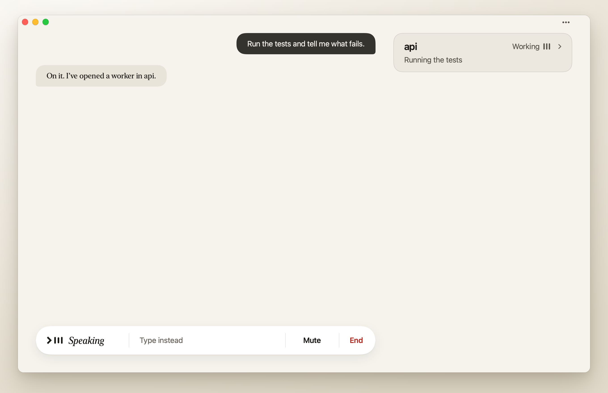
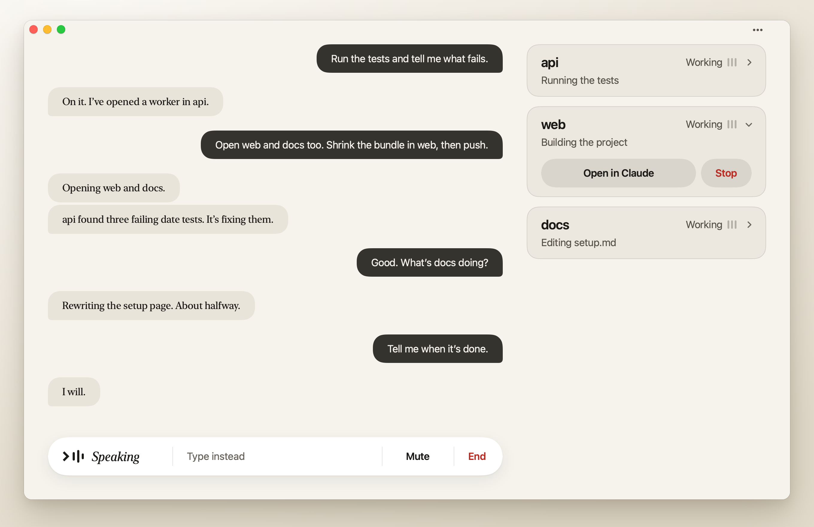
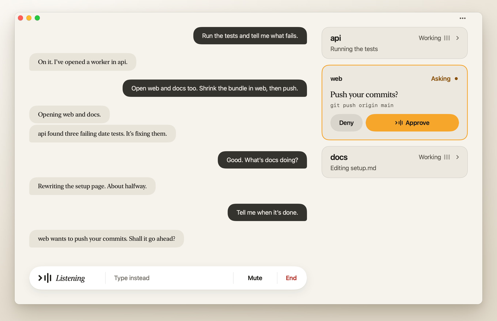
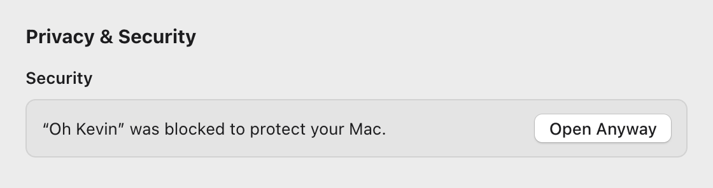

<picture><source media="(prefers-color-scheme: dark)" srcset="media/lockup-dark.png"></picture>

**Kevin is a voice you call on your Mac.** Tell him what you need, and he runs several Claude Code jobs at once while you keep working.

 

<picture><source media="(prefers-color-scheme: dark)" srcset="media/oh-kevin-loop-dark.webp"></picture>

## How it works

### 1. Say what you want done

Start a call and talk. Kevin answers at once and gives the job to its own Claude Code session, shown as a card.

<picture><source media="(prefers-color-scheme: dark)" srcset="media/mac-say-dark.png"></picture>

### 2. Hand out more, and keep working

Each job gets its own worker. Ask how one is doing, open it in Claude, or stop it.

<picture><source media="(prefers-color-scheme: dark)" srcset="media/mac-work-dark.png"></picture>

### 3. Answer when Kevin needs you

Say "yes" for safe steps, or click **Approve**.

<picture><source media="(prefers-color-scheme: dark)" srcset="media/mac-ask-dark.png"></picture>

## Install

### macOS (Apple silicon, macOS 26)

1. **Open it, and click Open Anyway.** [Download](https://github.com/bekhruzbekswe/ohkevin/releases/download/app-feed/Oh-Kevin-App.dmg), drag Oh Kevin to Applications and open it. macOS blocks the first open because Oh Kevin is not signed by Apple; the code is open, here. Go to **System Settings › Privacy & Security**, scroll to Security and click **Open Anyway**. Only once; updates install by themselves.

   <picture><source media="(prefers-color-scheme: dark)" srcset="media/open-anyway-dark.png"></picture>
2. **Set up.** One window, three things: sign in to **Claude**, allow the **Microphone**, choose a **Project**. Kevin works through [Claude Code](https://claude.com/claude-code); if you don't have it yet, Oh Kevin helps you get it. It then downloads what a call needs, about 410 MB, most of it the voice (381 MB), and Apple's speech model if your Mac doesn't have it yet.
3. **Start the first call** and say hello. Kevin understands English for now.

### Other computers

A browser page for every other computer is coming soon.

## What leaves your Mac

No account, no server of ours, no tracking.

| What | Where it goes |
|---|---|
| Your speech | Nowhere. Apple's speech recognition turns it into text on your Mac. |
| Your words, and the files Claude Code reads | Anthropic, under your own Claude Code account |
| An update check | GitHub, where the releases are |

### What Claude Code may do

- **It works in auto mode:** it edits files, runs commands and uses the network without asking.
- **Its own safety checks** refuse what they judge dangerous.
- **A spoken "yes"** approves only edits, new files and git add, commit or new branch in the project. Everything else needs a click.

## When something goes wrong

- **You can't see its icon in the menu bar.** A full menu bar hides icons behind the notch. You don't need it: everything is in the Oh Kevin window.
- **The call can't hear you.** Oh Kevin says why; **Allow microphone** opens the right setting.
- **The call broke.** Oh Kevin reconnects by itself. If it can't, it says "Call lost": press **Call again**. Work so far is saved in Claude Code.
- **Anything else.** Oh Kevin says what failed in one line; **Show Log** in the ⋯ menu opens the log.

Voice

Kevin's voice is made on your Mac. It speaks as Fable, a British male voice; the three dots at the top right of the window choose another.

Settings

The three dots at the top right of the window:

| Setting | What it does |
|---|---|
| Project folder | The folder Claude Code works in. |
| Model | Opus, Sonnet, Haiku or Fable for the work. Kevin itself always runs on Haiku. |
| Voice | Which voice speaks. |

Uninstall

Quit Oh Kevin and delete the app. Then remove `~/Library/Application Support/Oh Kevin`, `~/Library/Logs/Oh Kevin`, and the app's file in `~/Library/Preferences`.

---

Build from source: [CONTRIBUTING.md](CONTRIBUTING.md) and [ARCHITECTURE.md](ARCHITECTURE.md). Licence: Apache 2.0, see [LICENSE](LICENSE) and [NOTICE](NOTICE).

*Oh Kevin is an independent project that works with Claude Code. It is not made by or affiliated with Anthropic. It runs your own, unmodified Claude Code under your own account, and never sees or handles your sign-in.*
